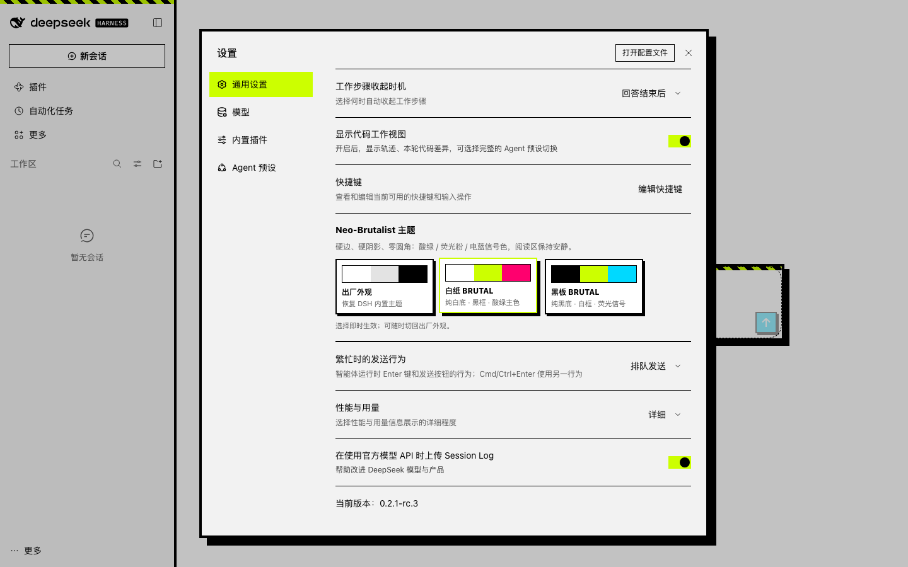
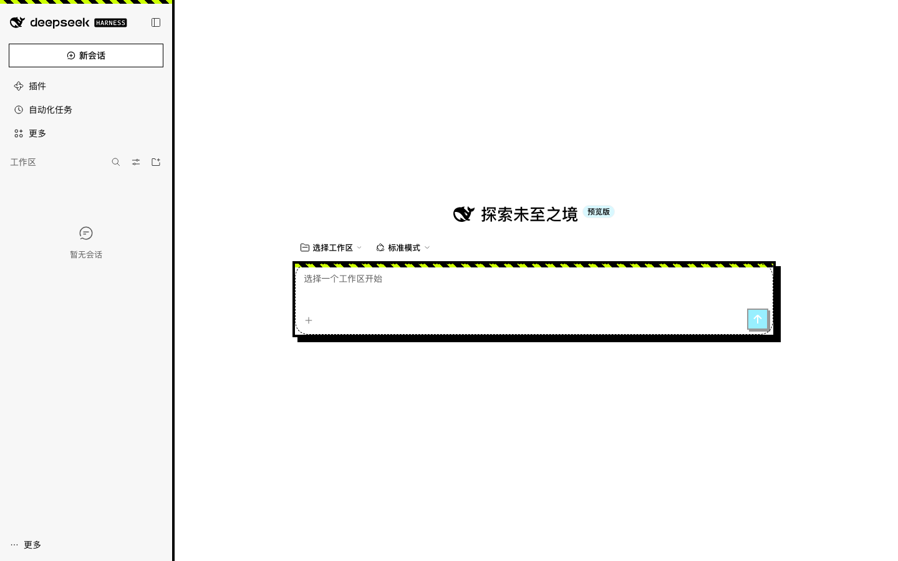
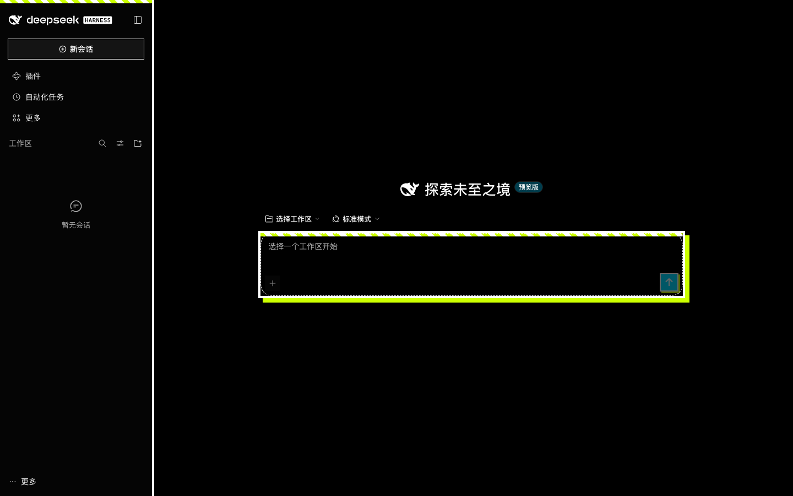
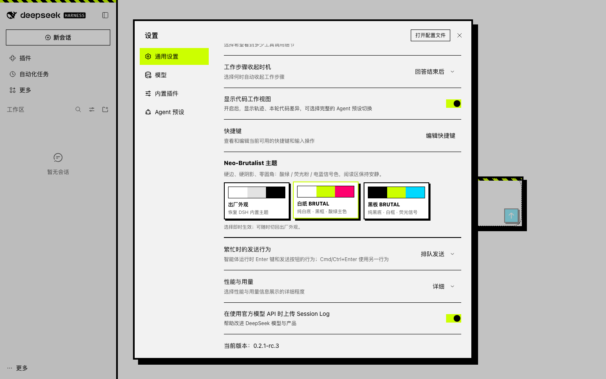

# dsh-theme-neo-brutalist

Neo-Brutalist 主题插件，给 DeepSeek Harness Web GUI 换上「硬边、硬阴影、零圆角、高对比荧光色」的外观。参考 [StyleKit 的 Neo-Brutalist 规范](https://www.stylekit.top/styles/neo-brutalist/showcase)，但只改外壳、不牺牲对话阅读体验。



| 白纸 BRUTAL | 黑板 BRUTAL |
| --- | --- |
|  |  |

## 特性

- **两套主题，设置内一键切换**：`白纸 BRUTAL`（纯白底 / 黑框 / 酸绿主色）与 `黑板 BRUTAL`（纯黑底 / 白框 / 荧光信号）。
- **安装后自动启用**：首次加载按当前明暗自动套用对应版本；之后记住选择。不想用时在 **设置 → 通用 → Neo-Brutalist 主题** 里点「出厂外观」即可完全恢复。
- **真正的 neo-brutalist 结构**：4px 硬边、8px 无模糊偏移阴影、零圆角、`150ms ease-out` 硬切；侧栏与输入区顶部有 45° 酸绿/黑警示斜纹；发送键按下会「物理压碎」（位移并压平阴影）。
- **StyleKit 信号色**：酸绿 `#ccff00`、荧光粉 `#ff006e`、电蓝 `#00d9ff`、橙 `#ff9500`，纯黑/纯白做结构。
- **阅读区保持安静**：只给外壳、输入区、弹层、工具卡、Goal 条、代码块加硬边；不改对话排版、字号、行宽，不做全局渐变或模糊。
- **可访问性**：正文对比度 ≥ 7:1、链接 ≥ 4.5:1、主按钮 ≥ 4.5:1（见 `test/theme.test.mjs` 自动校验）；键盘焦点 3px 荧光粉描边；遵循 `prefers-reduced-motion`。
- **干净的生命周期**：主题注册、样式表、body 标记、监听器全部挂在插件生命周期上，禁用/卸载即恢复原样。
- **零外部依赖**：不加载网络字体、图片、音频；不依赖 CSS-module 哈希类名。

设置页里的主题行：



## 安装

插件兼容 **DSH Web 0.2.1 线**（在 `0.2.1-rc.3` 上完成端到端验证，见 [`docs/VERIFICATION.md`](docs/VERIFICATION.md)）。

### 本地目录安装（开发 / 自用）

```sh
# 在插件目录内，一条命令安装到 Web profile
./scripts/install-local.sh

# 安装到 DSH Desktop 的 desktop profile：先完全退出桌面应用，再执行，然后重新打开
./scripts/install-local.sh desktop

# 卸载时把 install 换成 uninstall
./scripts/uninstall-local.sh desktop
```

脚本会自动找到 DSH 自带的 `dsh` CLI（macOS 桌面版路径）；非标准安装可设 `DSH_CLI=/path/to/dsh`。也可以直接调用：

```sh
dsh plugin --profile web add /absolute/path/to/dsh-theme-neo-brutalist
```

安装后重启对应的 `dsh web` / 桌面应用。Host 只在启动时扫描浏览器插件清单，所以新增插件需要重启一次；之后换主题都是即时的。

> DSH Desktop 的 `desktop` profile 归应用自己的插件管理器所有。若命令行安装被应用覆盖或拒绝，可以 `npm pack` 生成 tarball 后发布/安装，或把插件发布到 npm 后从插件市场安装。

### 压缩包安装

```sh
npm pack                    # 生成 dsh-theme-neo-brutalist-0.1.0.tgz
dsh plugin --profile web add ./dsh-theme-neo-brutalist-0.1.0.tgz
```

### 发布到插件市场

1. `npm publish`（包名 `dsh-theme-neo-brutalist` 当前未被占用）。
2. 到 [awesome-dsh-plugin](https://github.com/awesome-dsh-plugin/awesome-dsh-plugin) 提交 PR 增加一条目录项，分类填 `theme`。市场和发现页会自动收录；主题页支持互斥切换。

## 使用

1. 打开 **设置 → 通用**，滚动到 **Neo-Brutalist 主题**。
2. 点 `白纸 BRUTAL` 或 `黑板 BRUTAL`。选择立即生效并跨重启保留。
3. 点 `出厂外观` 恢复 DSH 内置的浅色/深色/跟随系统。之后再点内置外观，插件不会抢回主题。

偏好记录在浏览器 `localStorage` 的 `dsh-theme-neo-brutalist.preference`；主题本身通过 DSH 官方 `ctx.theme` 服务注册与切换。

## 卸载

```sh
dsh plugin --profile web remove dsh-theme-neo-brutalist
```

卸载或热禁用会释放主题注册、移除样式和 `body[data-dsh-neo-brutalist]` 标记，界面恢复原样。

## 开发与验证

```sh
npm run check        # node --check
npm test             # token 完整性 / 对比度 / CSS 门控 / 注入契约
```

端到端验证使用独立 `DSH_HOME` + 独立端口的 `dsh web` 实例，Playwright 驱动系统 Chrome，覆盖首次自动启用、白纸/黑板切换、设置行、390px 移动端、出厂恢复，并断言无 console/page error。结果：**39/39 hard assertions 通过**（另有 8/9 soft checks，1 项为 harness 元检查的预期 WARN）。详见 [`docs/VERIFICATION.md`](docs/VERIFICATION.md)。

## 文件结构

```text
dsh-theme-neo-brutalist/
├── package.json          # dsh.bundle.patch + dsh.client 清单
├── cordis.patch.yml      # 唯一的 loader 行
├── index.js              # Host 半：空 apply()
├── client.js             # 浏览器半：主题注册 + 结构 CSS + 设置行
├── test/theme.test.mjs   # 不依赖浏览器的静态校验
├── docs/                 # 验证说明与截图
└── DESIGN.md             # 设计系统说明
```

## 已知边界

- DSH 的聊天气泡、Markdown 根节点、工具卡内部等使用 CSS-module 哈希类名；主题刻意只改稳定语义 hook 和设计 token，不碰这些内部结构，因此气泡圆角等细节仍由 DSH 自身决定。
- 头像、状态点等身份/状态圆形未强制改成方形，保留可识别性；按钮、输入、弹层、卡片一律零圆角。
- 本插件是纯展示插件，不注册任何模型可见的工具，不影响 agent 行为。
